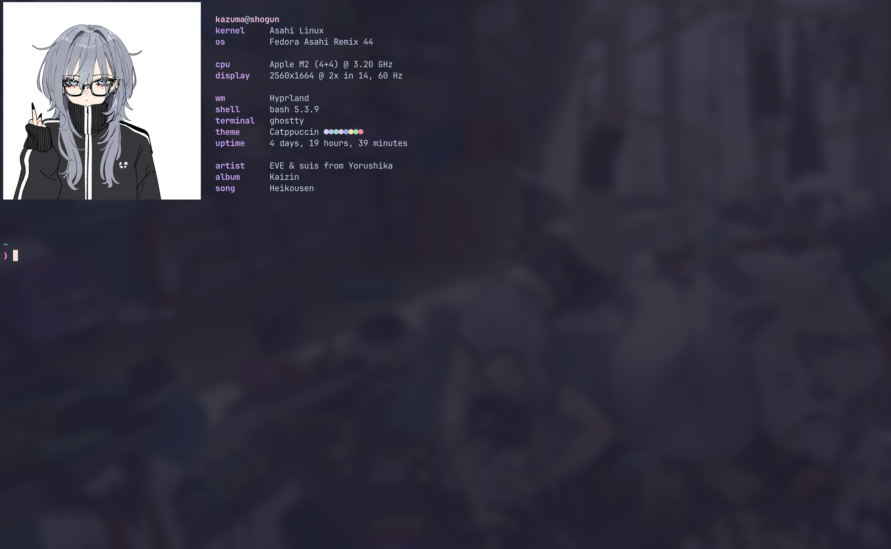

# anifetch

A lightweight C wrapper around `fastfetch` / `neofetch` that uses the standalone `kitten` binary to render an image next to your system info via the Kitty graphics protocol.

**Why:** `neofetch --backend kitty` needs a full Kitty installation. anifetch only needs the static `kitten` binary, so it works in terminals like Ghostty and WezTerm too.



## Features

- 🖼️ **Side-by-side rendering**: image on the left, system info on the right
- 🎲 **Random image per run**: point it at a directory and it picks an `image_*` file
- 🔐 **Encrypted image support**: keep images as `.gpg` files; they are decrypted in memory and never written to disk
- ⚙️ **Configurable**: image width/height, spacing, crop mode, fetch backend
- 🎨 **Crop modes**: `auto` (preserve aspect ratio) or `fill`
- 🚀 **Fast**: plain C, no shell involved (`fork` + `exec` everywhere)

## Prerequisites

- Linux
- A terminal that supports the Kitty graphics protocol: [Kitty](https://sw.kovidgoyal.net/kitty/), [WezTerm](https://wezfurlong.org/wezterm/) or [Ghostty](https://ghostty.org/)
- A fetch backend: `fastfetch` (default) or `neofetch`
- `script` (from util-linux, normally preinstalled). The fastfetch backend runs through it so fastfetch believes it has a TTY and keeps its colors
- `gcc` or `clang`
- `kitten` static binary (see below)
- `gpg`, only if you use encrypted images

## Installation

### 1. Download the `kitten` static binary

```bash
sudo curl -L https://github.com/kovidgoyal/kitty/releases/download/nightly/kitten-linux-amd64 \
     -o /usr/local/bin/kitten
sudo chmod +x /usr/local/bin/kitten
```

Use `kitten-linux-arm64` instead on ARM machines. The static binary works standalone; Kitty does not need to be installed.

### 2. Compile

```bash
gcc -O3 -o anifetch main.c
sudo mv anifetch /usr/local/bin/anifetch
```

### 3. Create the config

```bash
mkdir -p ~/.config/anifetch
```

Create `~/.config/anifetch/config.conf`:

```ini
# Image width in terminal columns
img_width=40

# Image height in rows. 0 (or unset) = match the height of the fetch output
img_height=0

# Space between the image and the text, in columns
text_offset=5

# "auto" (preserve aspect ratio, transparent background) or "fill"
crop_mode=fill

# "fastfetch" (default) or "neofetch"
backend=fastfetch

# A file inside your image directory (see "How images are picked")
image_path=~/Pictures/anime/image_01.png
```

Lines starting with `#` are ignored. If the config file is missing, defaults are used and a warning is printed.

## Usage

```bash
anifetch              # random image_* file from the directory of image_path
anifetch DIR          # random image_* file from DIR
anifetch FILE         # show exactly this file
anifetch -h | --help
anifetch -v | --version
```

anifetch refuses to run as root. `sudo` strips the display-related environment variables, which breaks rendering.

### How images are picked

- **No argument:** the filename is stripped from `image_path` to get a directory, and a random file whose name **starts with `image_`** is chosen from it. If none match, the exact `image_path` is used as a fallback.
- **Directory argument:** same random pick, but from the directory you gave.
- **File argument:** used directly, no scanning.

Only filenames beginning with `image_` are considered (up to 256 per directory). Any extension works, e.g. `image_01.png`, `image_02.webp`, `image_03.png.gpg`.

### Encrypted images

If the chosen file ends in `.gpg`, anifetch asks for a passphrase (echo off) and decrypts it in memory.

Encrypt an image (symmetric, passphrase-based):

```bash
gpg --symmetric --cipher-algo AES256 -o image_01.png.gpg image_01.png
shred -u image_01.png   # remove the plaintext original
```

What happens at runtime:

1. `gpg` is launched with `--batch --pinentry-mode loopback --passphrase-fd 3 -d`. The passphrase goes over a pipe on fd 3, so it never appears in `argv` or `ps`.
2. The decrypted bytes are read from `gpg`'s stdout into a buffer (locked with `mlock` on a best-effort basis to keep it out of swap).
3. The buffer is piped to `kitten icat --stdin=yes`, then wiped.

A wrong passphrase or a corrupt file prints `Decryption failed (wrong passphrase or bad file).`

> **Note:** anifetch decides by the `.gpg` extension only. Every run that picks an encrypted file prompts for the passphrase, so avoid pointing shell startup at an encrypted directory. Plain `image_*` files in the same directory work without a prompt.

## Configuration options

| Option | Type | Default | Description |
|--------|------|---------|-------------|
| `img_width` | integer | `40` | Image width in terminal columns |
| `img_height` | integer | `0` | Image height in rows. `0` uses the number of lines the fetch backend printed |
| `text_offset` | integer | `5` | Columns between the image and the text |
| `crop_mode` | string | `auto` | `auto` or `fill` |
| `backend` | string | `fastfetch` | `fastfetch` or `neofetch` (anything else falls back to fastfetch) |
| `image_path` | string | none | A file inside your image directory; `~/` is expanded |

### Crop modes

- **`auto`**: keeps the original aspect ratio with a transparent background. Good for portraits or when you want to see the whole image.
- **`fill`**: scales the image to fill the allocated space. Good for a consistent look across different images.

## Customizing the fetch output

anifetch just displays what the backend prints (`fastfetch --logo none` or `neofetch --off`), so customize those tools themselves:

- fastfetch: `~/.config/fastfetch/config.jsonc`
- neofetch: `~/.config/neofetch/config.conf` ([example config](https://git.jelius.dev/jelius-sama/dotfiles/src/branch/neofetch))

## Troubleshooting

**Image not displaying**
1. Check that your terminal supports the Kitty graphics protocol.
2. Run `kitten icat /path/to/image.jpg` directly.
3. Make sure the file exists and is readable. anifetch prints `image file '...' not found` otherwise.

**`no image_ files found in '...'`**
Your files must be named `image_something.ext`. Other names are ignored when scanning a directory (pass the file directly to bypass this).

**`Decryption failed`**
- Check the passphrase.
- Check `gpg` is installed and the file really is a symmetric `gpg` file.
- Test outside anifetch: `gpg -d image_01.png.gpg | kitten icat --stdin=yes`.

**`Run without sudo privilege!`**
Run it as your normal user.

**Text colors missing (fastfetch)**
Make sure `script` is installed; the fastfetch backend depends on it.

**Gap between output and prompt**
This is normal. The image height determines the spacing. Adjust `img_width` or `img_height` to change it.

**Config not loading**
- `cat ~/.config/anifetch/config.conf`
- `ls -la ~/.config/anifetch/config.conf`
- Look for warnings printed when the program starts.

## How it works

1. Loads `~/.config/anifetch/config.conf`.
2. Resolves which image to show (file, directory scan, or config hint).
3. If the image is `.gpg`, prompts for the passphrase and decrypts it into memory.
4. Runs the backend (`fastfetch --logo none` through `script`, or `neofetch --off`) and captures its output.
5. Clears the screen and runs `kitten icat --place <w>x<h>@0x0` to draw the image on the left, from the file or from stdin for encrypted images.
6. Moves the cursor and prints each fetch line to the right of the image.
7. Parks the cursor below everything, with no extra gap.

## Limitations

- Linux only.
- Up to 100 fetch lines, 512 characters each; paths up to 1024 characters.
- Encryption is detected by the `.gpg` extension, not by inspecting file contents.

## Credits

- Uses the [Kitty graphics protocol](https://sw.kovidgoyal.net/kitty/graphics-protocol/)
- Inspired by [neofetch](https://github.com/dylanaraps/neofetch)
- Terminal compatibility ideas from various dotfiles in the community

## License

[MIT License](./LICENSE)
